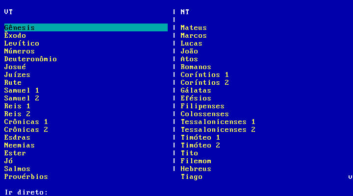

# Bíblia ACF para DOS

## English

ACF Bible reader for DOS, written in Turbo Pascal and designed for text-mode environments such as DOSBox-X and FreeDOS.



### Features

- text-mode Bible reader for DOS
- binary content files optimized for old environments
- direct navigation by book, chapter, and verse
- support for CP850 Portuguese text

### Main Files

- `BIBLIA.PAS`: main Turbo Pascal source
- `BIBLIA.EXE`: compiled DOS executable
- `make_dos_data.py`: generates `ACF.DAT`, `ACF.IDX`, and `ACF.MET`
- `ACF.DAT`, `ACF.IDX`, `ACF.MET`: Bible data files
- `START.BAT`: codepage/keyboard setup and launcher
- `TP55/`: Turbo Pascal 5.5

### Run in DOSBox-X

Inside DOS:

```dos
START.BAT
```

Quick file-read test:

```dos
BIBLIA.EXE /T
```

### Build the EXE

Inside DOSBox-X:

```dos
TPC.EXE /B BIBLIA.PAS
```

From the host:

```bash
dosbox-x -fastlaunch -exit \
  -c "mount c /path/to/BibliaDOS" \
  -c "c:" \
  -c "cd \\" \
  -c "TP55\\TPC.EXE /B BIBLIA.PAS"
```

### Generate Bible Data

```bash
python3 make_dos_data.py --json /path/to/acf_clean.json
```

Expected output:

- `ACF.DAT`
- `ACF.IDX`
- `ACF.MET`

`acf_clean.json` is not included in this repository. It must be a UTF-8 JSON list of books, each with `name`, `abbrev` and `chapters` (a list of chapters, each a list of verse strings). The script warns about characters that have no CP850 equivalent (they become `?` in DOS).

### Main Keys

- `Enter`: select
- `ESC` or `b`: go back (on the books view it asks before quitting)
- `q`: quit
- `F1`: help
- arrow keys, `PgUp`, `PgDn`: navigate
- books view: `Left/Right` switches OT/NT columns
- books view: type `ap 22 1` and press `Enter` to jump directly; abbreviations (`gn`, `hb`, `1co`...) or the start of the book name work, with or without accents (`genesis 1 1`, `exodo 3 14`); `job` = Jó (`jo` = João)
- reading view: `Left/Right` changes chapter
- reading view: `g` jumps to verse

### Encoding

The data uses `CP850` for Portuguese text. If accents look wrong, switch to codepage 850.

`START.BAT` already applies:

- `CHCP 850`
- `KEYB BR 850`

## Português

Leitor da Bíblia ACF para DOS, feito em Turbo Pascal e pensado para ambientes texto como DOSBox-X e FreeDOS.


### Funcionalidades

- leitor bíblico em modo texto para DOS
- arquivos binários de conteúdo otimizados para ambientes antigos
- navegação direta por livro, capítulo e verso
- suporte a texto em português com CP850

### Arquivos Principais

- `BIBLIA.PAS`: fonte principal em Turbo Pascal
- `BIBLIA.EXE`: executável DOS compilado
- `make_dos_data.py`: gera `ACF.DAT`, `ACF.IDX` e `ACF.MET`
- `ACF.DAT`, `ACF.IDX`, `ACF.MET`: arquivos de dados da Bíblia
- `START.BAT`: configuração de codepage/teclado e inicialização
- `TP55/`: Turbo Pascal 5.5

### Rodar no DOSBox-X

Dentro do DOS:

```dos
START.BAT
```

Teste rápido de leitura:

```dos
BIBLIA.EXE /T
```

### Compilar o EXE

Dentro do DOSBox-X:

```dos
TPC.EXE /B BIBLIA.PAS
```

No host:

```bash
dosbox-x -fastlaunch -exit \
  -c "mount c /caminho/para/BibliaDOS" \
  -c "c:" \
  -c "cd \\" \
  -c "TP55\\TPC.EXE /B BIBLIA.PAS"
```

### Gerar os Dados Bíblicos

```bash
python3 make_dos_data.py --json /caminho/para/acf_clean.json
```

Saída esperada:

- `ACF.DAT`
- `ACF.IDX`
- `ACF.MET`

O `acf_clean.json` não está neste repositório. Ele deve ser uma lista JSON (UTF-8) de livros, cada um com `name`, `abbrev` e `chapters` (lista de capítulos, cada um uma lista de versos). O script avisa sobre caracteres sem equivalente em CP850 (que virariam `?` no DOS).

### Teclas Principais

- `Enter`: selecionar
- `ESC` ou `b`: voltar (na tela de livros, pergunta antes de sair)
- `q`: sair
- `F1`: ajuda
- setas, `PgUp`, `PgDn`: navegar
- tela de livros: `Left/Right` alterna entre colunas VT/NT
- tela de livros: digite `ap 22 1` e pressione `Enter` para ir direto; vale abreviação (`gn`, `hb`, `1co`...) ou o começo do nome, com ou sem acento (`genesis 1 1`, `exodo 3 14`); `job` = Jó (`jo` = João)
- tela de leitura: `Left/Right` muda de capítulo
- tela de leitura: `g` vai para o verso

### Codificação

Os dados usam `CP850` para texto em português. Se os acentos aparecerem errados, mude para a codepage 850.

O `START.BAT` já aplica:

- `CHCP 850`
- `KEYB BR 850`

## Licença / License

O texto bíblico é a Almeida Corrigida Fiel (ACF), © Sociedade Bíblica Trinitariana do Brasil. Verifique os termos de uso da SBTB antes de redistribuir os arquivos `ACF.*`.

The Bible text is the Almeida Corrigida Fiel (ACF), © Sociedade Bíblica Trinitariana do Brasil. Check SBTB's terms of use before redistributing the `ACF.*` files.
